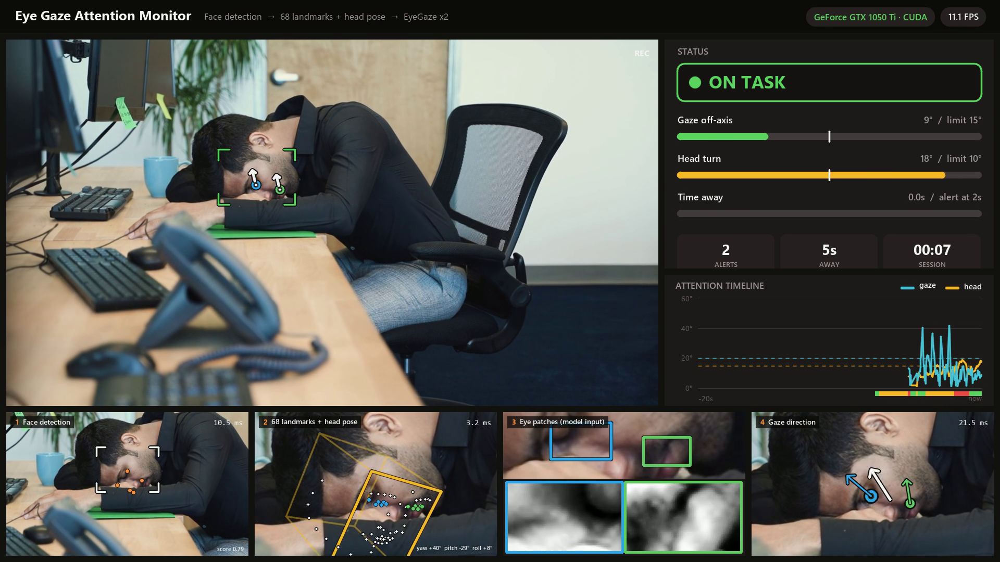

# Eye Gaze Attention Monitor

**Real-time attention tracking from a webcam: it knows where you are looking, and raises
an alert when your attention moves away.**

Three neural networks run one after another on every frame, on a laptop GPU, with nothing
sent to the cloud:

```
webcam frame
   │
   ├─▶ 1. Face detection        face_det_lite      480×640 grayscale → face box + 5 points
   ├─▶ 2. Landmarks + head pose facemap_3dmm       128×128 face crop → 68 landmarks, yaw/pitch/roll
   ├─▶ 3. Eye patches           geometry           each eye warped to the exact 160×96 frame
   │                                                EyeGaze was trained on
   └─▶ 4. Gaze direction        EyeGaze            both eyes in one batched call → 3D gaze
                                       │
                                       ▼
          3-second calibration ─▶ attention state machine ─▶ ON TASK / LOOKING AWAY / ATTENTION LOST
```

If your gaze leaves a 20° cone around the calibrated direction, **or** your head turns more
than 15°, for more than **2 seconds**, it shows **ATTENTION LOST** and beeps.



**Use cases:** online exam proctoring, driver distraction alerts, control-room and
CCTV operators, e-learning engagement, focus tracking.

## Features

- **3 AI models, live**: face detection, 68 facial landmarks + head pose, per-eye gaze.
- **GPU accelerated** with ONNX Runtime + CUDA graphs (falls back to CPU automatically).
- **3-second calibration** per person, then a robust attention state machine
  (smoothing, hysteresis, two cues: eyes and head).
- **Studio view** for demos: live camera, status card, attention timeline and all four
  model stages side by side. Also a simple monitor view and a 2×2 pipeline view.
- **Built-in 1080p recording** (H.264) of the window, screenshots, CSV logs.
- **Any webcam**, a video file, or an **Android phone camera over USB** (no extra apps).
- **Private**: frames are processed in memory; nothing is uploaded.

## Quick start

You need Python 3.10–3.13. An NVIDIA GPU is optional (it makes it about 5× faster).

```bash
git clone https://github.com/jahanzaibtahir2006/eye-gaze-attention-monitor.git
cd eye-gaze-attention-monitor
```

**Windows** (PowerShell):

```powershell
.\run.ps1
```

**Linux / macOS**:

```bash
chmod +x run.sh
./run.sh
```

The first run creates a virtual environment and installs everything. Then:

1. Sit in front of the webcam and look at your screen.
2. Press **C** and keep looking at the screen for 3 seconds (calibration).
3. Look away, at your phone or anywhere else. The state turns yellow, and after 2 seconds
   it shows **ATTENTION LOST** and beeps. Look back and it turns green again.

| Key | Action |
|---|---|
| `C` | calibrate (again) |
| `V` | switch view: studio → monitor → pipeline |
| `R` | start / stop recording to `recordings/*.mp4` (1080p H.264) |
| `S` | screenshot to `recordings/` |
| `H` | toggle the stats line (monitor view) |
| `O` | rotate the phone picture 90° (phone camera only) |
| `F` | fullscreen |
| `Q` / `Esc` | quit |

### Manual install

```bash
python -m venv .venv
# NVIDIA GPU:
.venv/bin/pip install -r requirements.txt        # Windows: .venv\Scripts\pip ...
# No NVIDIA GPU / macOS:
.venv/bin/pip install -r requirements-cpu.txt
.venv/bin/pip install -e .
.venv/bin/gaze-monitor
```

No CUDA toolkit is needed: the CUDA 12 and cuDNN 9 runtimes come as pip packages.
`requirements.txt` pins versions that also work on older Pascal GPUs (GTX 10-series);
see the comments in that file.

### Command line

```bash
gaze-monitor --record                    # record a demo straight away
gaze-monitor --load-calib                # reuse the last calibration
gaze-monitor --source 1                  # another webcam
gaze-monitor --device cpu                # force the CPU
# a video file, no window: calibrate on its first 3 s, write an MP4 and a CSV log
gaze-monitor --source samples/desk-worker.mp4 --calibrate --no-display --record out.mp4 --csv out.csv
```

All options: `gaze-monitor --help`. Defaults live in [config.toml](config.toml); put your
own overrides in a `config.local.toml` next to it (same keys, ignored by git).

### Android phone as the camera (optional)

A phone's front camera is usually much sharper than a laptop webcam, and sharper eye
patches mean a steadier gaze. With `--source phone` the app streams the phone camera
straight in over USB: no scrcpy window, no OBS, no virtual-camera driver.

1. On the phone (Android 12+): Developer options → **USB debugging** on → connect by USB →
   tap **Allow**.
2. Download a [scrcpy](https://github.com/Genymobile/scrcpy/releases) release (it provides
   `adb` and the camera server). The app finds it in `Downloads`, or set `scrcpy-dir` in
   your `config.local.toml`.
3. Run with `--source phone`, mount the phone above the centre of your screen, press **O**
   if the picture comes in sideways, then **C** to calibrate.

If no phone is found, the app falls back to webcam 0.

## Performance

Measured with `tools/benchmark.py` on a laptop with an **NVIDIA GeForce GTX 1050 Ti (4 GB)**
and an Intel Core i5-8300H, on AC power, 1920×1080 video:

| | Face detection | Landmarks + pose | EyeGaze (both eyes) | Whole pipeline |
|---|---|---|---|---|
| **GPU (CUDA graphs)** | 4.6 ms | 1.9 ms | 13.0 ms | **16.5 ms · 60 FPS** |
| CPU (ONNX Runtime) | 12.5 ms | 2.0 ms | 38.8 ms | 78.0 ms · 13 FPS |

What makes it fast:

- **CUDA graphs**: each model is captured once and replayed as a single launch. These are
  networks of many small kernels, and launching them one by one left the GPU idle most of
  the time (13% utilisation); graphs made them 2–3× faster with identical outputs.
- **Both eyes in one batched call**, and EyeGaze exported **without its 1.57 MB heatmap
  output**, which the app never reads.
- **Threaded capture and rendering**: the camera is read on its own thread, and the 1080p
  view is drawn while the next frame is already on the GPU.

Laptops on battery throttle both GPU and CPU (we measured 3–4× slower). Plug in for demos.

## How it works

- **Letterbox, don't stretch.** The face detector takes a 4:3 image. A 16:9 frame is
  padded, not squashed, and the padding is undone when decoding boxes.
- **Warp, don't crop, the eyes.** EyeGaze was trained on patches centred on the midpoint of
  the two eye corners, 1.5× the corner distance wide. Any other crop silently shifts the answer.
- **Mirror the right eye.** The model was trained on left eyes: the right patch is flipped
  and its yaw negated.
- **Gaze is already camera-relative.** Rotating it by head pose counts the head twice.
- **Two cues.** EyeGaze under-reads big angles and barely moves when the eyes look down at a
  phone; head pose catches that. Gaze catches the eyes drifting while the head stays still.
- **Smooth, then threshold, with asymmetric hysteresis**, so one lucky frame cannot reset
  the timer. Arrows on screen use a One-Euro filter to remove flicker.
- **Calibrate per person.** About a third of the model's error is a fixed per-person bias,
  which the 3-second calibration removes.

**Accuracy:** EyeGaze is off by about 15° on average (about 10° after calibration). That
tells you *whether* someone is looking at the screen, not *which button* they are looking
at. The app classifies into a cone; it does not point.

## Project structure

```
src/gaze_monitor/
  cli.py         entry point, main loop, keys, recording, config
  pipeline.py    the three-model chain
  geometry.py    letterbox, 3DMM decode, eye warp, gaze vectors
  attention.py   calibration and the attention state machine
  filters.py     One-Euro filter for steady on-screen arrows
  runtime.py     ONNX Runtime sessions: CUDA graphs, CPU fallback
  overlay.py     studio / monitor / pipeline views, timeline
  video.py       threaded webcam, video files, H.264 recorder
  phone.py       Android phone camera over USB (scrcpy server + PyAV)
  text.py        anti-aliased text for OpenCV
  alerts.py      non-blocking beep
models/          the three ONNX models + 3DMM basis
tools/           export_onnx.py, benchmark.py, render_still.py
tests/           unit and end-to-end tests
samples/         test video and image (see samples/SOURCES.md)
```

Run the tests with `python -m pytest`.

### Re-exporting the models

The ONNX models in `models/` are exported from Qualcomm AI Hub's PyTorch sources and
checked against them on random input:

```bash
pip install torch --index-url https://download.pytorch.org/whl/cu126
pip install onnx "qai-hub-models[eyegaze,face-det-lite,facemap-3dmm]"
python tools/export_onnx.py
```

## Privacy and responsible use

Frames are processed in memory and discarded. Nothing is uploaded, and nothing is saved
unless you press `R`/`S` or pass `--record`/`--csv`. If you monitor anyone other than
yourself, get their consent first. This is a demonstration project, not a certified
driver-monitoring or proctoring system.

## Credits

- Built by **Jahanzaib Tahir**.
- Pipeline design based on
  [dragonwing-gaze-attention](https://github.com/SamuelAlexander/dragonwing-gaze-attention)
  by Samuel Alexander (Apache-2.0), ported here from the Qualcomm NPU to desktop GPUs.
- Models: Qualcomm AI Hub (BSD-3-Clause): EyeGaze, Lightweight-Face-Detection,
  Facial-Landmark-Detection.
- Phone streaming uses the [scrcpy](https://github.com/Genymobile/scrcpy) server (Apache-2.0).

Licensed under the Apache License 2.0. See [LICENSE](LICENSE) and [NOTICE](NOTICE).
